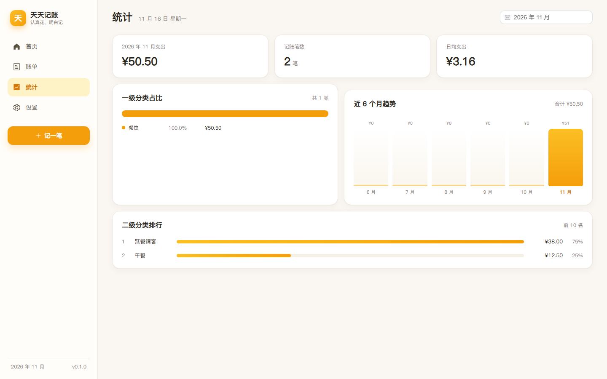
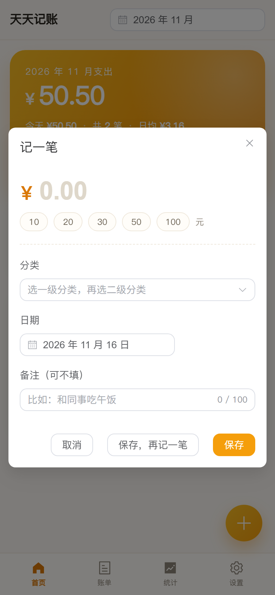
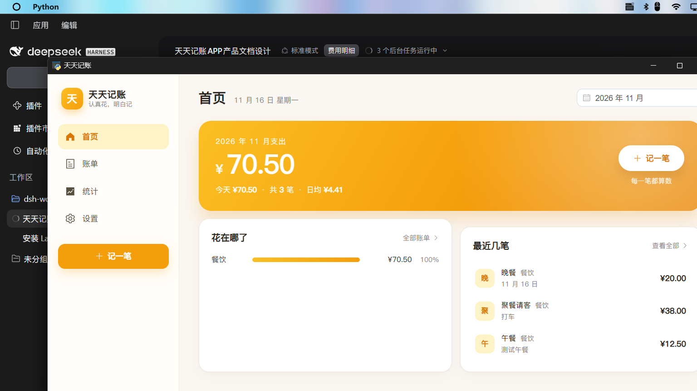

# 天天记账 · TianTian

一款只做「支出记录」的桌面记账应用：人民币、两级分类、数据全部留在本机。
Windows 与 macOS 共用一套代码，界面优先宽屏，同时适配小窗口和手机尺寸。

- 技术栈：FastAPI + SQLModel + SQLite（后端），Vue 3 + Element Plus（前端），PyWebView（桌面外壳）
- 数据目录：Windows `%APPDATA%\TianTianJiZhang`，macOS `~/Library/Application Support/TianTianJiZhang`
- 产品文档与所有技术决策记录：[`../dsh.md`](../dsh.md)

## 界面预览

| 首页 | 账单 |
| --- | --- |
|  |  |

| 统计 | 记一笔 |
| --- | --- |
|  |  |

| 导入结果 | 桌面原生窗口 |
| --- | --- |
|  |  |

## 目录结构

```
tiantian/
├── backend/
│   ├── app/
│   │   ├── main.py          # FastAPI 入口、静态文件、SPA 回退
│   │   ├── config.py        # 数据目录、版本
│   │   ├── db.py            # SQLite、启动备份、建表
│   │   ├── models.py        # Category / Expense / Setting
│   │   ├── schemas.py       # 请求与响应结构
│   │   ├── seed.py          # 10 个一级、67 个二级分类
│   │   ├── services.py      # 共用查询与序列化
│   │   └── routers/         # categories / expenses / stats / export
│   └── requirements.txt
├── frontend/
│   ├── src/
│   │   ├── views/           # 首页、账单、统计、设置
│   │   ├── components/      # 记一笔弹窗
│   │   ├── api.js           # 接口封装
│   │   └── state.js         # 全局状态
│   └── package.json
├── scripts/
│   ├── build_windows.ps1    # Windows 打包
│   └── tiantian.iss         # Inno Setup 安装包脚本
├── run.py                   # 一键启动（内置服务 + 桌面窗口）
└── README.md
```

## 一、准备环境

需要安装：

1. **Python 3.12**（本项目固定用 3.12；**不要用 3.14**，PyWebView 依赖的 pythonnet 在 3.14 下无法加载原生窗口）
2. **Node.js 20 或更高**（自带 npm）

检查：

```powershell
python --version
node --version
npm --version
```

> Windows PowerShell 如果提示「npm.ps1 无法加载」，请把命令里的 `npm` 换成 `npm.cmd`。

## 二、安装依赖

### 1. 后端

在项目根目录执行：

```powershell
python -m venv .venv
.\.venv\Scripts\python.exe -m pip install -r backend\requirements.txt
```

macOS：

```bash
python3 -m venv .venv
./.venv/bin/python -m pip install -r backend/requirements.txt
```

### 2. 前端

```powershell
cd frontend
npm.cmd install
cd ..
```

## 三、开发模式

开两个终端。

终端 A（后端，改代码会自动重载）：

```powershell
cd backend
..\.venv\Scripts\python.exe -m uvicorn app.main:app --reload --port 8000
```

终端 B（前端，改代码会自动刷新）：

```powershell
cd frontend
npm.cmd run dev
```

浏览器打开 <http://127.0.0.1:5173>。

也可以只用一个命令（后端 + 桌面窗口，前端仍需另开 `npm run dev`）：

```powershell
.\.venv\Scripts\python.exe run.py --dev
```

## 四、正式运行

先构建前端，再启动：

```powershell
cd frontend
npm.cmd run build
cd ..

.\.venv\Scripts\python.exe run.py
```

`run.py` 会自动找一个空闲端口启动内置服务，然后打开桌面窗口。关闭窗口即退出。

只启动后端（不开窗口）：

```powershell
.\.venv\Scripts\python.exe run.py --no-window
```

## 五、数据与备份

| 内容 | 位置 |
| --- | --- |
| 数据库 | `<数据目录>\tiantian.db` |
| 自动备份 | `<数据目录>\backups\`，最多 7 份 |
| 导出 CSV | 设置页或账单页点「导出 CSV」，导出当前月份 |
| 导入 CSV | 设置页「导入账单」，选择本应用导出的 CSV；重复记录自动跳过 |

- 每次启动会自动备份一次数据库。
- 想换位置，可设置环境变量 `TIANTIAN_DATA_DIR` 指向新目录。
- 备份文件是完整数据库副本，改名成 `tiantian.db` 放回数据目录即可恢复。

## 六、打包成安装包

### Windows

前置：安装 [Inno Setup 6](https://jrsoftware.org/isinfo.php)。

```powershell
powershell -ExecutionPolicy Bypass -File scripts\build_windows.ps1
```

产物：

- `dist\TianTianJiZhang\`：免安装目录版，双击 `TianTianJiZhang.exe` 即可运行
- `release\TianTianJiZhang-Setup-0.3.0.exe`：安装包（需先装 Inno Setup）

当前已构建并验证的免安装包：`release\TianTianJiZhang-0.3.0-win64-portable.zip`（约 22 MB）。v0.3.0 新增“彻底删除”（回收站里可把记录真正抹掉，不自动清理）；v0.2.0 新增 CSV 导入；v0.1.1 修复了无控制台打包时 `Unable to configure formatter 'default'`（`sys.stderr` 为 None）的启动崩溃。

> Windows 10/11 一般自带 WebView2 运行时；如果窗口白屏，请安装
> [Microsoft Edge WebView2 Runtime](https://developer.microsoft.com/microsoft-edge/webview2/)。

### macOS

**推荐：用 GitHub Actions 在云端 Mac 上打包**（不需要自己有 Mac 开发环境）

1. 把本目录推到 GitHub 仓库（见下一节）。
2. 打开仓库的 **Actions** 页 → 左侧「Build Desktop App」→ 右侧「Run workflow」。
3. 等约 5–10 分钟，任务完成后在该次运行页面底部下载：
   - `TianTian-macOS-AppleSilicon`：Apple 芯片（M1/M2/M3/M4）用
   - `TianTian-macOS-Intel`：Intel 芯片用
   下载得到的 zip 里还套着一层同名 zip（GitHub 会自动再压一次），解压两层就是 `TianTianJiZhang.app`。
4. 解压得到 `TianTianJiZhang.app`，拖进「应用程序」文件夹。

> 仓库里的 `release/mac/` 已放好这两个包（`apple.zip` / `intel.zip`），不用再自己跑 Actions。
> 两个包已在 Windows 上校验：zip 结构完整，主程序分别是 arm64 / x86_64；尚未在真机 Mac 上启动过。

> 这个包没有 Apple 开发者签名，第一次打开会被 macOS 拦下。解决办法：
> 右键点 App →「打开」→ 再点「打开」；或到「系统设置 → 隐私与安全性」点「仍要打开」。
> 若提示“已损坏”，在终端执行：`xattr -dr com.apple.quarantine /Applications/TianTianJiZhang.app`

**备选：直接在 Mac 上从源码运行/打包**

```bash
cd frontend && npm install && npm run build && cd ..
python3 -m venv .venv
./.venv/bin/python -m pip install -r backend/requirements.txt pyinstaller
./.venv/bin/pyinstaller --noconfirm --clean --windowed --name TianTianJiZhang \
  --add-data "frontend/dist:frontend/dist" --paths backend run.py
```

产物在 `dist/TianTianJiZhang.app`。只运行不打包也可以：`./.venv/bin/python run.py`。

### 用 GitHub Actions 自动构建

仓库里已带 `.github/workflows/build.yml`：推送到 GitHub 后，在 Actions 页面手动运行
「Build Desktop App」，会同时产出 Windows、Apple 芯片 macOS、Intel macOS 三个压缩包。

## 七、常见问题

**1. 打开窗口一片空白**
先确认 `frontend/dist/index.html` 存在（执行过 `npm run build`）。开发模式请访问 5173，而不是后端端口。

**2. 端口被占用**
`run.py` 会自动选空闲端口；开发模式的 8000/5173 被占用时，换端口并同步修改 `vite.config.js` 的代理。

**3. 后端依赖装不上**
把 pip 缓存和临时目录指到项目内，或使用国内镜像：

```powershell
.\.venv\Scripts\python.exe -m pip install -r backend\requirements.txt -i https://pypi.tuna.tsinghua.edu.cn/simple
```

**4. 数据库想推倒重来**
关闭应用，删除数据目录里的 `tiantian.db`，下次启动会重新建表并写入默认分类（备份里仍有旧数据）。

**5. Windows 报 `0x80131515` / “从网络位置加载程序集”**
如果项目放在某些非系统盘（本机 D: 就是这种情况），.NET Framework 会把程序集当成“远程来源”拒绝加载。在 Python 解释器旁边放一个 `python.exe.config`，内容：

```xml
<?xml version="1.0" encoding="utf-8"?>
<configuration>
  <runtime>
    <loadFromRemoteSources enabled="true" />
  </runtime>
</configuration>
```

放到 `.venv\Scripts\python.exe` 和基础 Python 的 `python.exe` 旁边（打包后放到 `TianTianJiZhang.exe` 旁边）。装在 C: 盘通常不需要这一步。

**6. 桌面窗口打不开、自动跳浏览器**
说明 PyWebView 的原生后端加载失败。先确认 Python 是 3.12；仍失败时用 `run.py --no-window` 走浏览器模式，功能完全一样。

**7. 双击 exe 弹 `Unhandled exception ... Unable to configure formatter 'default'`**
v0.1.0 的打包版在“无控制台”模式下启动时会踩到 uvicorn 日志组件的一个问题（`sys.stderr` 为 None）。v0.1.1 起已修复：启动时把 stdout/stderr 接到空设备，并让启动备份失败不阻断应用。请使用 `release\TianTianJiZhang-0.2.0-win64-portable.zip`。

**8. 导入 CSV 时提示“缺少列”或很多无效行**
请用本应用「导出 CSV」得到的文件，不要自己改列名。必填列是：`日期,一级分类,二级分类,金额(元)`，`备注` 可选；日期支持 `2026-11-16`、`2026/11/16`、`2026.11.16`。分类名必须和设置页里的完全一致；对不上的会归入「其他 / 未分类」并在结果里提示。

**9. 同一个 CSV 导入两次会翻倍吗**
不会。按「日期 + 金额 + 一级分类 + 二级分类 + 备注」判断，已存在的记录会跳过，结果框里会显示跳过了多少条。

## 八、接口速查

启动后端后打开 <http://127.0.0.1:8000/docs> 可看交互式接口文档。

| 方法 | 路径 | 说明 |
| --- | --- | --- |
| GET | `/api/health` | 健康检查、数据目录 |
| GET | `/api/categories` | 两级分类树 |
| GET | `/api/expenses?month=YYYY-MM` | 账单列表（支持分类、搜索、分页） |
| POST | `/api/expenses` | 新增一笔 |
| PATCH | `/api/expenses/{id}` | 修改 |
| DELETE | `/api/expenses/{id}` | 软删除（移进回收站，可恢复） |
| POST | `/api/expenses/{id}/restore` | 恢复（从回收站拿回来） |
| DELETE | `/api/expenses/{id}/permanent` | 彻底删除（仅限已进回收站的记录，不可恢复） |
| GET | `/api/stats/summary?month=YYYY-MM` | 月度汇总、分类占比、二级排行 |
| GET | `/api/stats/trend?months=6` | 近 N 月趋势 |
| GET | `/api/export/csv?month=YYYY-MM` | 导出 CSV |
| POST | `/api/import/csv` | 导入 CSV（JSON 传 `{"content": "..."}`） |
